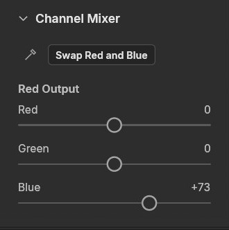
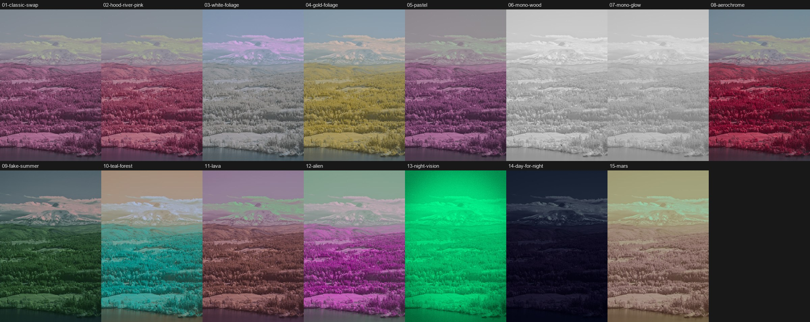
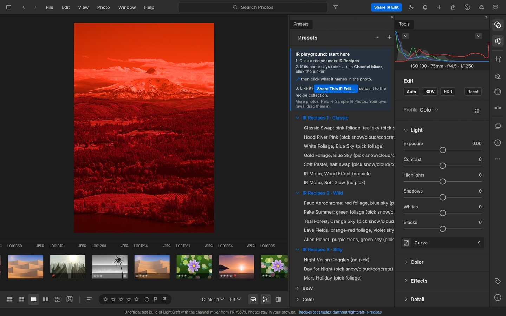
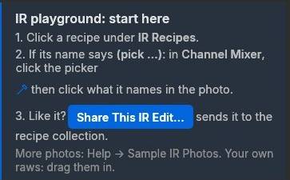
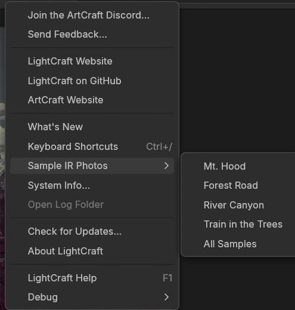
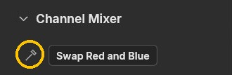
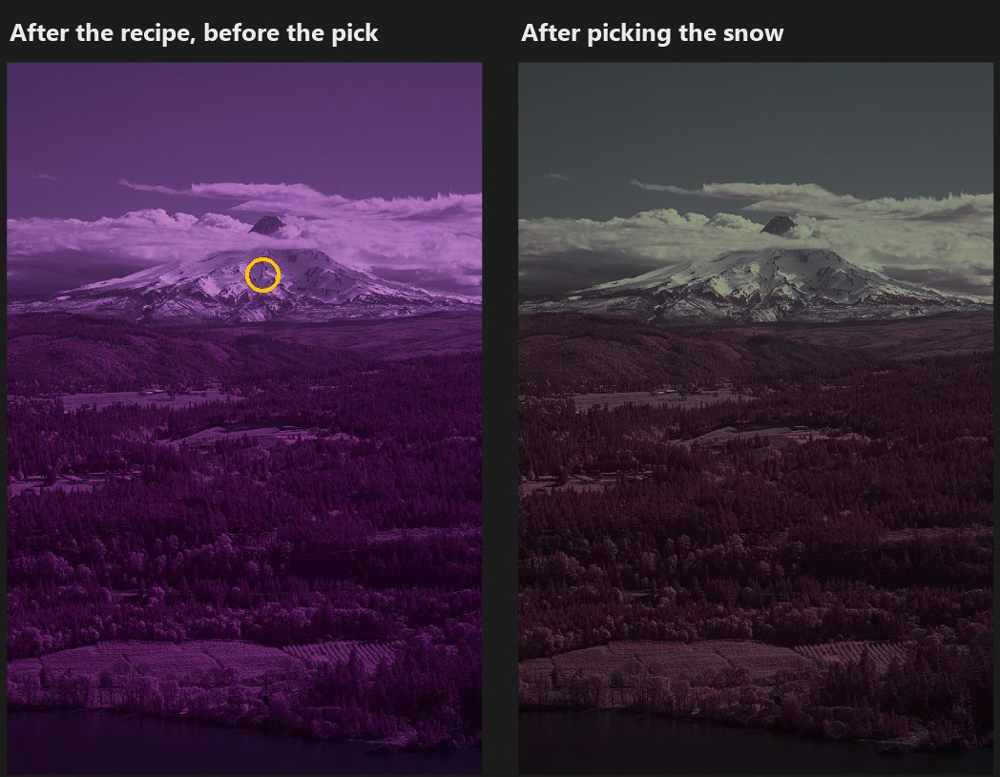
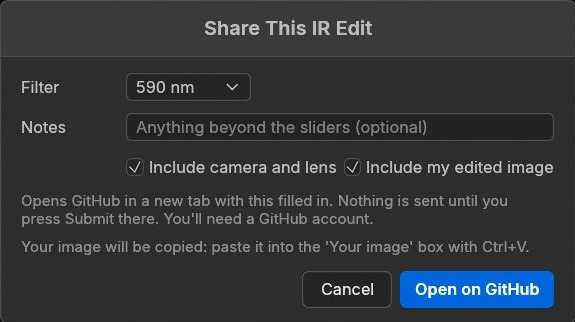

# Test a channel mixer for infrared photos in LightCraft

[LightCraft](https://github.com/storytold/lightcraft) is an open-source photo editor modelled on Lightroom. Like
Lightroom, it has no **channel mixer**, the tool infrared photographers need for the classic red/blue channel swap,
which usually means a round trip through Photoshop. Pull request
[storytold/lightcraft#3579](https://github.com/storytold/lightcraft/pull/3579) adds one, and **it needs testing by
people who shoot IR** before it can be merged.

**Not official, not part of LightCraft:** this is a test build by the pull request's author.

## The channel mixer: what to test



It sits in the edit panel under **Channel Mixer**:

- **Red, Green and Blue Output:** each output channel is a mix of the photo's red, green and blue (−200 to +200 %).
  This is the same model as Photoshop's channel mixer, so numbers from Photoshop tutorials carry over.
- **Swap Red and Blue:** the classic IR swap in one click.
- **The neutral picker** (the eyedropper): click something that should be white or grey, like snow, cloud or
  concrete, and it balances the mix so that spot comes out neutral. This replaces the usual "white balance on foliage,
  then swap" dance.

**What would help most:**

- **Edits from your camera and filter.** Everything so far was made on one camera: a Sony A6000 with a 590 nm filter.
  665, 720 and 850 nm, full-spectrum and other sensors are untested. [Share your edits](#4-share-your-edit).
- **Problems.** A pick that fails or gives a strange cast, sliders that behave oddly, a raw that won't open, anything
  that's confusing: [open an issue](https://github.com/darthnut/lightcraft-ir-recipes/issues/new) and say what
  you did.
- **Comparisons.** If you also edit IR in Photoshop or another editor, does the same mix give the same result here?

To get started, there are **fifteen recipes** (presets) built on the mixer: some look good, some look wild, a few look
silly on purpose. They're starting points; open the Channel Mixer after applying one to see how it's made.



## Try it in your browser

### ▶ [Open the IR playground](https://darthnut.github.io/lightcraft-ir-recipes/)

A test build of LightCraft with the channel mixer and these recipes built in, running entirely in your browser:

- **Nothing to install.** Use a laptop or desktop; it's tested in Chrome and is too cramped on a phone.
- **Your photos stay on your computer.** They're stored in the browser, never uploaded.
- **The first visit downloads about 35 MB** (the app and one sample raw), then the browser keeps it.
- **It's slower than a desktop app:** each change takes a second or two to render on a 24 MP raw.

### 1. Start here

The playground opens on a 590 nm photo of Mt. Hood, with the recipes on the right and a short "start here" card
(to use your own photos, see [below](#use-your-own-ir-photos)):





More sample photos: **Help ▸ Sample IR Photos** has three more (a forest road, a river canyon and a train).



### Use your own IR photos

Either way works:

- **Drag** one or more files from your computer onto the playground window, or
- choose **File ▸ Import Photos…** and pick them.

They appear in the strip of thumbnails along the bottom; **click one** to edit it. Raw files work best (Sony ARW,
Canon CR2/CR3, Nikon NEF, Fujifilm RAF, Olympus ORF, Panasonic RW2, Pentax PEF, DNG and more), but JPEG, TIFF and PNG
work too. A JPEG has already had the camera's white balance and colours baked in, so recipes have less to work with.

Your photos never leave your computer: the playground copies them into your browser's own storage, so they're still
there next time you visit. They do take up space there; the originals on your computer aren't touched.

### 2. Mix, or start from a recipe

**The mixer is what's being tested, so please play with it directly.** In **Channel Mixer**, press **Swap Red and
Blue** or set the Red, Green and Blue Output sliders yourself, then pick a neutral spot (step 3) and keep adjusting.
Try the mixes you'd use in Photoshop, and try breaking it.

**Recipes are a shortcut:** click one under **IR Recipes 1 · Classic**, **2 · Wild** or **3 · Silly**, then open
Channel Mixer to see how it's made and change it from there. If a recipe's name ends in **(no pick)**, it needs no
step 3.

### 3. If it says "(pick …)", pick

Most recipes fit themselves to your photo with one click. In the **Channel Mixer** section, click the picker:



Then click on what the recipe names:

- **snow/cloud/concrete:** anything that should come out white or grey.
- **foliage:** bright leafy trees or grass.



Then set **Exposure** (in **Light**) to taste: the picker never changes it. If a strong mix had to be scaled down to
fit the sliders, a message says how much darker the photo came out ("Darker by 0.4…"): raise Exposure by about that
much. Highlights and Shadows are yours to play with too.

**Switching recipes:** pick once, then click through recipes freely. The playground remembers where you picked on
each photo and re-picks that same spot for every recipe you click (the preview while hovering shows the re-picked
result too, and one undo takes back recipe and pick together). It only reuses a pick of the same kind: going between a
"snow/cloud/concrete" recipe and a "(pick foliage)" one, pick once more. The spot is forgotten when you reload the
page.

This is a playground convenience: in LightCraft itself, a recipe resets the mixer, so pick again after each one.

**"Pick a brighter, less saturated area":** click somewhere brighter. Snow and clouds are the safest.

### 4. Share your edit

Like what you made? Press the blue **Share IR Edit** button (top bar, start-here card, or under the Channel Mixer):



Pick your filter, add a note if you like, and press **Open on GitHub**. A new tab opens a GitHub issue that's already
filled in with your settings and, if ticked, your camera and lens. Your edited image is copied for you:
**click the "Your image" box and press Ctrl+V** (⌘V on a Mac). Then press **Submit**.

- **Nothing is sent until you press Submit** on GitHub, and you need a free GitHub account for that.
- **The image carries no hidden data:** it's re-encoded at 2048 px with no EXIF, GPS, serial number or file name.
  The camera and lens appear only as the text you can see (or untick) in the issue.
- If the paste doesn't work, the same image was also saved to your Downloads folder as `lightcraft-ir-edit.jpg`:
  drag it into the box instead.

**Shared edits can become recipes.** Some may be added here, credited, so the next person with a 665 or 720 nm camera
has a starting point.

## Share without the playground

Already have IR numbers from Photoshop, GIMP, Affinity, Capture One or another editor's channel mixer?
[Share them with this form](https://github.com/darthnut/lightcraft-ir-recipes/issues/new?template=share-recipe.yml):
it asks for your filter, camera, white balance and mixer values.

## The recipes

The fifteen recipes now live in their own repository,
**[darthnut/lightcraft-ir-presets](https://github.com/darthnut/lightcraft-ir-presets)**: what each one does, how they
were made, and downloads (all fifteen in one file, or one at a time). The playground has the same recipes built in.

## Using a desktop build instead

The playground is the easy way in. For full speed, build the pull request's branch yourself (you need
[Rust](https://rustup.rs)):

```bash
git clone --branch feat/channel-mixer https://github.com/darthnut/lightcraft.git lightcraft-mixer
```

```bash
cd lightcraft-mixer
```

```bash
cargo run --release -p lightcraft -- --library ~/lightcraft-mixer-test
```

The `--library` folder keeps this test build away from your real LightCraft library. Then download
the recipes from [lightcraft-ir-presets](https://github.com/darthnut/lightcraft-ir-presets/releases/latest) and, in the
Presets panel, click **Import Presets…** and choose them.

The playground itself is built from the `ir-playground` branch of
[darthnut/lightcraft](https://github.com/darthnut/lightcraft/tree/ir-playground).

Made by darthnut with Claude (Anthropic). Licensed MIT or Apache-2.0, like LightCraft. The sample photos are by
darthnut, shared under [CC BY-NC 4.0](https://creativecommons.org/licenses/by-nc/4.0/): free to use and adapt with
credit, not for commercial use.
